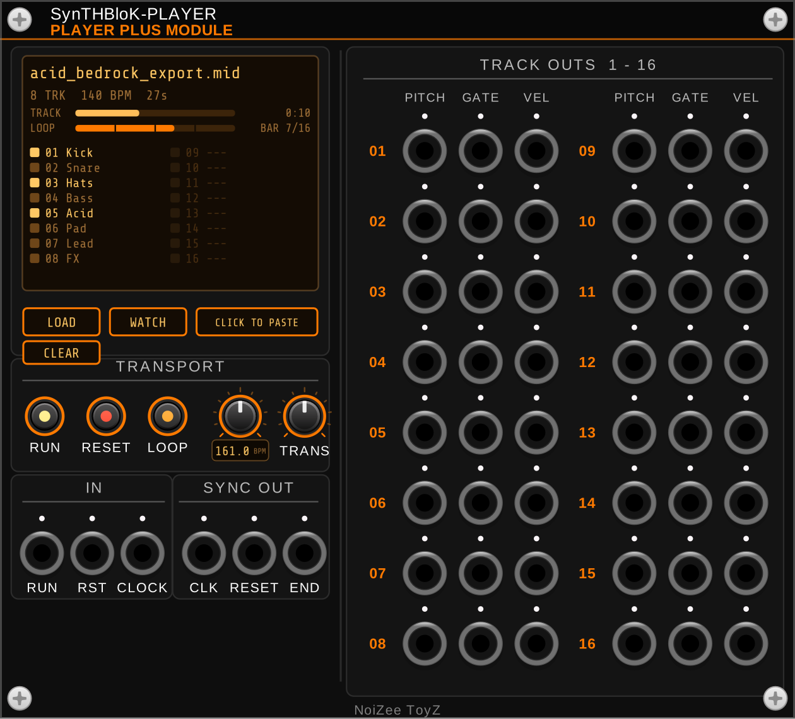
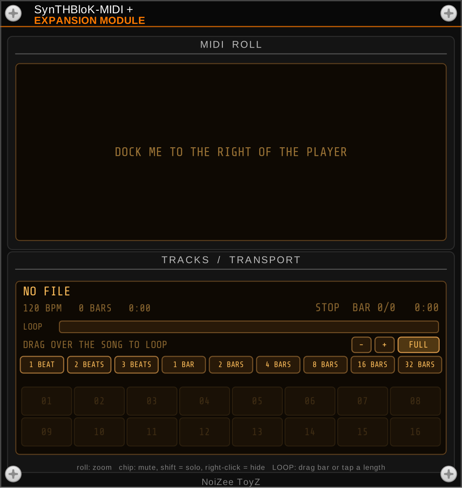

# SynTHBloK Player Plus

A free VCV Rack 2 plugin by **NoiZee ToyZ** (part of the SynTHBloK series).




| Module | What it does |
|---|---|
| **Player Plus** | MIDI file player with a watch folder: 16 poly tracks (pitch, gate, velocity), 16th-note clock, reset and end outputs, speed and transpose |
| **MIDI + Expansion** | MIDI display for Player Plus: scrolling piano roll of the loaded MIDI with playhead, track activity and transport readout |

## Install

In VCV Rack 2: **Library**, search **SynTHBloK Player Plus**, **Add**.

## Build

```
make RACK_DIR=/path/to/Rack-SDK   # or: make dist / make install
```

## Licence

GPL-3.0-or-later (see `LICENSE.txt`). The SynTHBloK and NoiZee ToyZ names and logos are not covered by the licence.
